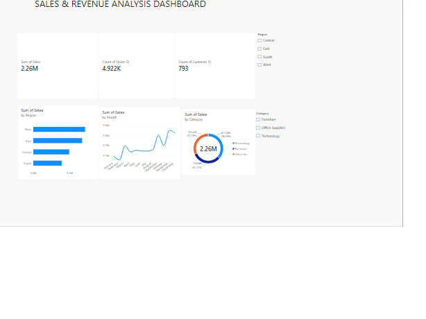

# Sales & Revenue Analysis Dashboard

## Objective
Analyze sales performance across regions, categories and time to find growth opportunities.

## Tools
Power BI, Excel

## Dataset
Superstore Sales (Kaggle), 9,800 rows

## Key Metrics
- Total Sales: 2.26M
- Total Orders: 4,922
- Total Customers: 793

## Insights
1. West region generates the highest sales; South is the lowest.
2. Sales peak in the last quarter (Sep to Dec), showing strong seasonality.
3. Sales are lowest in January and February.
4. Recommendation: increase inventory and marketing before September.

## Dashboard

